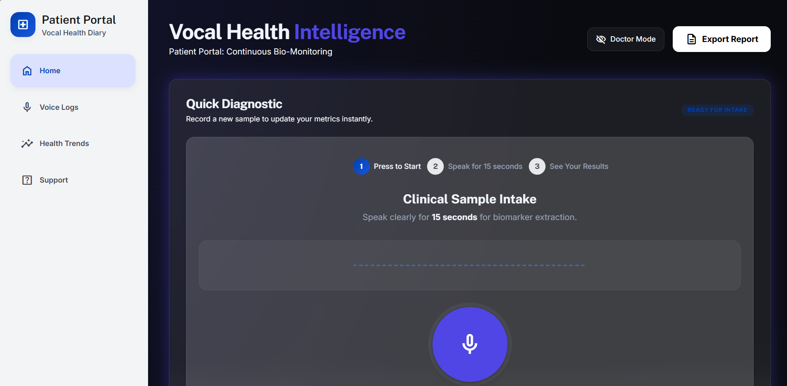
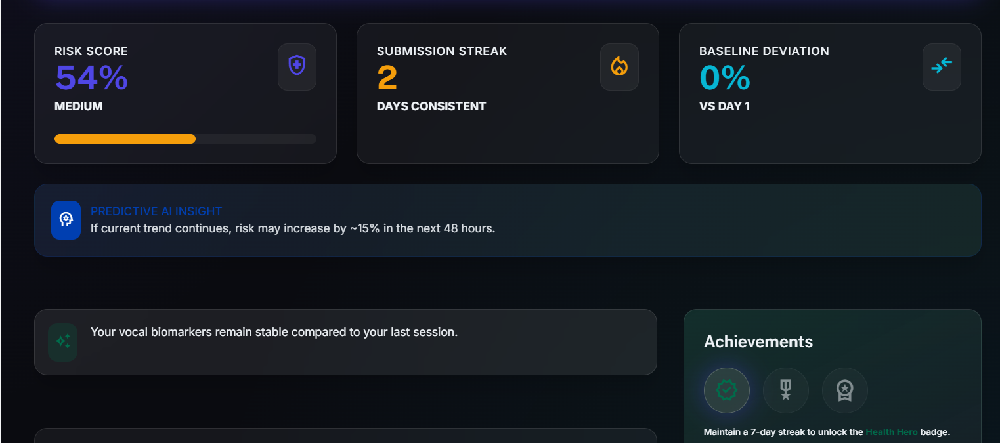
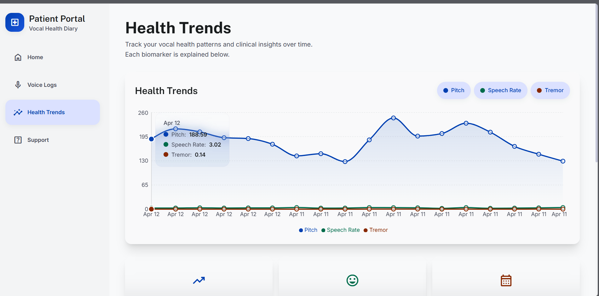
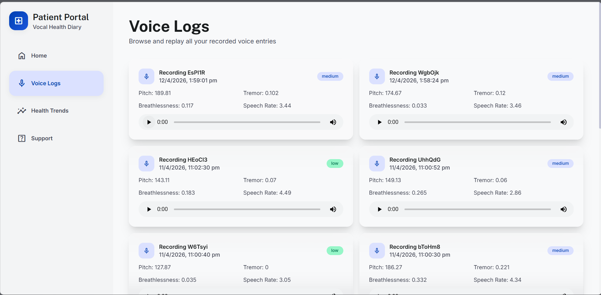
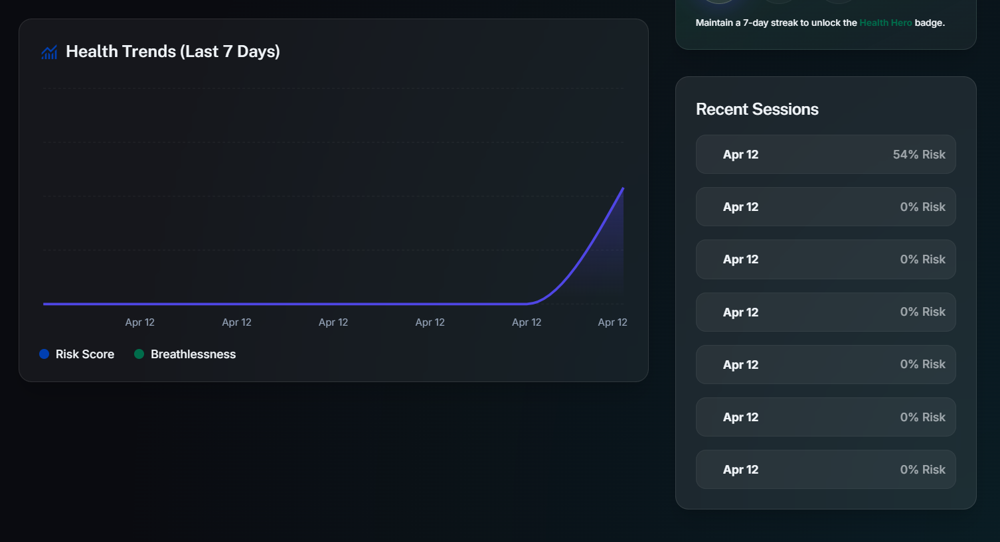
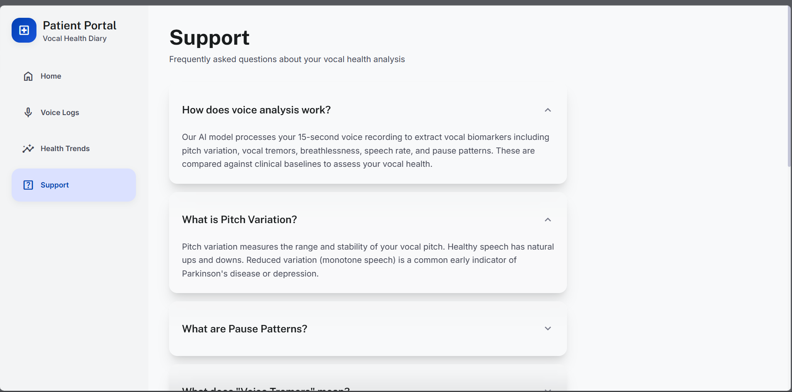
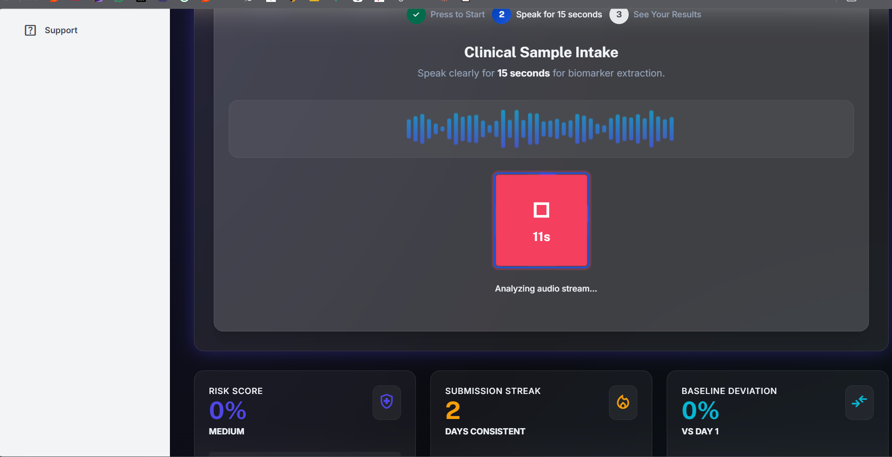

# 🎙️ EchoHealth: AI Voice Health Analytics

> **Decoding wellness through the power of voice.**

EchoHealth is a cutting-edge AI-driven platform that analyzes vocal biomarkers to provide insights into potential mental and physical health indicators.



---

## ✨ Features

### 🔍 Advanced Voice Biomarkers

Extract high-fidelity biomarkers from simple voice recordings. Our system analyzes:

- **Tone & Pitch**: Tracking variation and stability.
- **Tremor Analysis**: Measuring micro-oscillations in vocal signals.
- **Breathlessness Index**: Measuring respiratory strain during speech.
- **Speech Rate**: Analyzing cognitive pacing and verbal fluency.



### 🤖 AI-Driven Health Insights

Powered by a custom-trained Scikit-learn model, EchoHealth analyzes vocal features to estimate potential health risk indicators, including depression-related indicators.

### 📊 Real-time Dashboard

A premium, dark-mode dashboard featuring glassmorphism aesthetics. Monitor your health trends with interactive charts, history logs, and AI-generated insights.



### 📂 Voice Health Logs

Keep a complete timeline of your sessions. Each entry is timestamped and analyzed, allowing you to track your vocal measurements over weeks and months.



### 📈 Historical Trends

Visualize your progress over time with a dedicated 7-day history view, allowing for easy identification of changes in vocal biomarkers.



### 🏥 Clinical Support & Insights

Get personalized wellness insights and recommendations to seek professional evaluation when concerning indicators are detected.



---

## 🛠️ Tech Stack

- **Frontend**: React.js, Vite, Tailwind CSS, Framer Motion (for smooth animations).
- **Backend**: Node.js, Express.js.
- **AI/ML Service**: Python (Flask), Scikit-learn, NumPy, Librosa/FFmpeg for audio processing.
- **Database**: MongoDB / PostgreSQL (configured via `.env`).

---

## 🚀 Getting Started

### Prerequisites

- Node.js (v18+)
- Python (v3.9+)
- FFmpeg (for audio decoding)

### Installation

1. **Clone the Repository**

   ```bash
   git clone https://github.com/iamsm-x/EchoHealth.git
   cd EchoHealth
   ```

2. **Frontend Setup**

   ```bash
   cd frontend
   npm install
   npm run dev
   ```

3. **Backend Setup**

   ```bash
   cd backend
   npm install
   npm start
   ```

4. **AI/ML Service Setup**

   ```bash
   cd ai_ml
   pip install -r requirements.txt
   python app.py
   ```

---

## 🧠 How it Works

1. **Capture**: The user speaks into the microphone; audio is captured in high-quality WAV format.
2. **Decode**: The system uses a native Python decoder and FFmpeg as a fallback to ensure cross-platform compatibility.
3. **Extract**: Features like MFCCs, Spectral Centroids, and Zero Crossing Rates are extracted.
4. **Predict**: The pre-trained AI model evaluates the features to generate an experimental risk score.
5. **Insights**: Results are visualized on the user's dashboard with analysis summaries and wellness recommendations.

---

## 🛡️ License

Distributed under the MIT License. See `LICENSE` for more information.

---

Built with ❤️ for **HackNext Hackathon 2026**.

## 👨‍💻 Developer

**Soham Sandesh Mate**

GitHub: [@iamsm-x](https://github.com/iamsm-x)

---

## 🖼️ Gallery

<div align="center">
  
  
  
  
  
  
</div>

---

<p align="center">
  **EchoHealth – Decoding Wellness Through the Power of Voice.**
  <br>
  Developed by <b>Soham Sandesh Mate</b> ❤️
</p>

> **Disclaimer:** EchoHealth is an experimental wellness and educational project. Its predictions are not clinically validated and must not be used as a substitute for professional medical diagnosis or treatment.